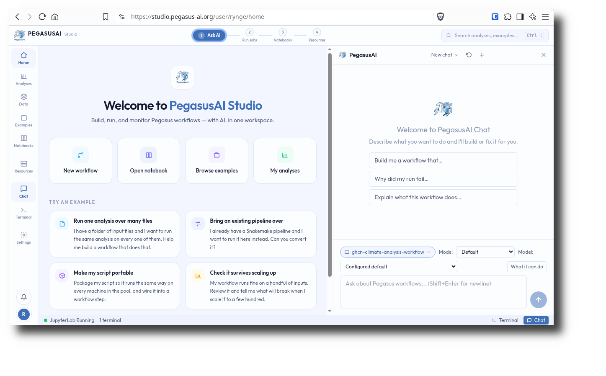

# Pegasus AI Studio

## Overview

Pegasus AI Studio is an Open OnDemand Batch Connect app that launches Pegasus AI as an interactive web server session on HPC clusters. It is designed for users who wants to user AI agents to design and execute scientific workflows.

- Upstream project: [project homepage](https://pegasus-ai.org/) [software homepage](https://pegasus.isi.edu/)

## Screenshots

<!-- A screenshot helps deployers verify their installation and helps users understand what they'll get. -->
<!-- Place images in a screenshots/ or docs/ directory. -->



## Features

- Launches Pegasus AI Studio via web server on compute nodes
- Supports submitting Pegasus jobs to Slurm
- Containerized via Singularity/Apptainer

## Requirements

### Compute Node Software

- Singularity / Apptainer
- RHEL/Rocky/... 9 or greater

### Open OnDemand

- Scheduler: Slurm

## App Installation

```bash
cd /var/www/ood/apps/sys

git clone https://github.com/pegasus-isi/bc_pegasus_ai_studio.git

```

If Apptainer/Singularity is not in the PATH on your compute nodes, update
`template/script.sh.erb` so that Apptainer/Singularity is loaded.

Download one or more Singularity images, and install them in a shared directory:

[https://download.pegasus.isi.edu/ondemand/6.0/]

Update the image path in `form.yml.erb`

## Where Studio keeps its files

Studio runs with a **Studio directory** as its home (`~/pegasus-studio` unless
the user picks another on the launch form), never the user's real home.
Everything Studio writes is `$HOME`-relative: its database, workflows,
`~/.pegasusrc`, and the configuration it generates for Codex, Claude Code and
OpenCode. Running it in the real home would overwrite a user's own setup of
those tools.

- `template/studio-home.sh` refuses the real home itself, any directory
  containing it, symlinks back to either, and `.`/`..` components.
- `.condor/tokens.d` and `.gitconfig` are symlinked in from the real home when
  present (and when nothing is already there), so HTCondor submission and git
  identity keep working. Sites can change the list with `STUDIO_HOME_INHERIT`
  in `template/script.sh.erb`, and the default directory with
  `STUDIO_HOME_DEFAULT`.
- The real home is still bind-mounted, so terminals can reach existing data.
- One session per Studio directory runs at a time.

The Studio directory must be on storage the HTCondor submit host also mounts.
Studio's planning and DAGMan read the workflow's submit directory from there.
The default under an NFS home works; node-local scratch does not.

**Upgrading from 0.0.1:** earlier sessions wrote Studio's state straight into
the home directory (`~/.studio`, `~/workflows`, `~/data`, `~/.pegasusrc`, and
so on). A new session starts with an empty Studio directory. Move `~/workflows`
and `~/data` into it to keep existing projects.

Run the tests with `bash tests/test-studio-home.sh`.

## Site settings

An administrator configures every session through one file on the portal,
`/etc/ood/config/apps/bc_pegasus_ai_studio/site.env`. See
[`examples/site.env`](examples/site.env). It is read when the dashboard renders
the job script, so compute nodes need no copy. It sets:

- **Where workflows run.** `STUDIO_SITE_CATALOG_FILE` is a Pegasus site catalog
  for this cluster. It replaces Studio's default catalog, so site `compute`
  means this cluster's resources. Alternatively, `STUDIO_SITE_CATALOG` names a
  catalog published in
  [pegasushub/pegasus-site-catalogs](https://github.com/pegasushub/pegasus-site-catalogs).
- **The AI assistant.** `STUDIO_LLM_GATEWAY_URL` / `STUDIO_LLM_DEFAULT_MODEL`
  name a gateway the site runs. Without one, users add their own provider and
  key in Settings. Never put a shared API key here: every user can read their
  own session's environment.
- **The HTCondor access point.** `_CONDOR_SCHEDD_HOST` / `_CONDOR_COLLECTOR_HOST`,
  as fully qualified names, when sessions do not run on it.

## Workflows on Slurm

Studio submits workflows to HTCondor, so a Slurm cluster needs an HTCondor
access point whose jobs reach Slurm. The simplest route is HTCondor's BLAHP:
the catalog's `compute` site uses `grid_resource: batch slurm` and
`pegasus.style: glite`, and each job becomes an `sbatch` run as the user (see
`unity.yml` in pegasus-site-catalogs). The access point needs:

- the Slurm client (`sbatch`, `squeue`, munge) working for ordinary users;
- BLAHP, which ships with HTCondor; check `slurm` in `supported_lrms` and
  `slurm_binpath` in `/etc/blah.config`;
- a filesystem shared with the compute nodes for the Studio directory.

Nothing in Studio needs more than a user has: it submits, queries and
reschedules its own jobs, and reads the catalog.

## Known Limitations

- Only works on RHEL/Rocky/... 9 or greater, at this point

## Contributing

Contributions are welcome. To contribute:

1. Fork this repository
2. Create a feature branch (`git checkout -b feature/my-improvement`)
3. Submit a pull request with a description of your changes

For bugs or feature requests, [open an issue](https://github.com/pegasus-isi/bc_pegasus_ai_studio/issues).

This app is part of the [OOD Appverse](https://ondemand.connectci.org/affinity-groups/ood-appverse). Join the [Appverse Affinity Group](https://ondemand.connectci.org/affinity-groups/ood-appverse) to connect with other contributors.

## References

<!-- Credit upstream projects and any code you borrowed. -->

- [Pegasus AI](https://pegasus-ai.org/) — the application launched by this OOD app
- [Pegasus WMS](https://pegasus.isi.edu/) — the application launched by this OOD app
- [Open OnDemand](https://openondemand.org/) — the HPC portal framework

## License

[MIT License](LICENSE)

## Acknowledgments

This work is supported by the National Science Foundation award number 2513101.

